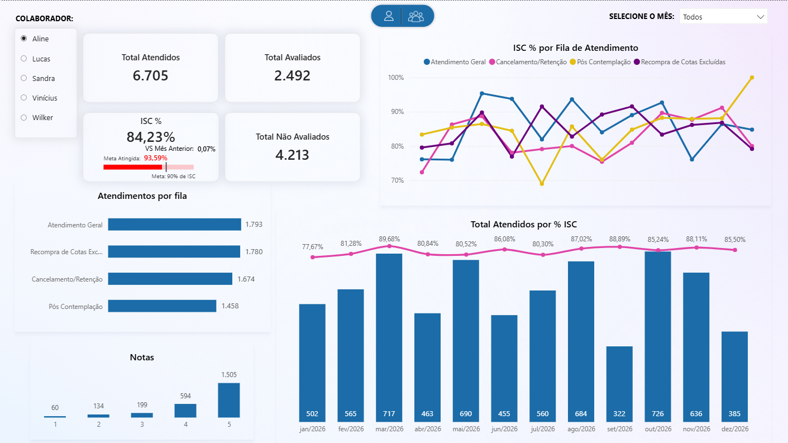
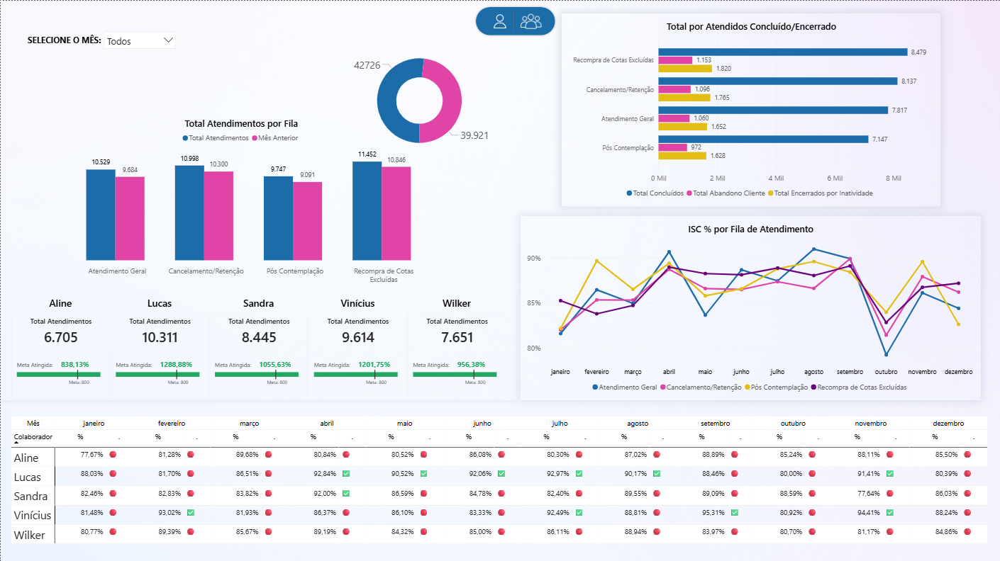
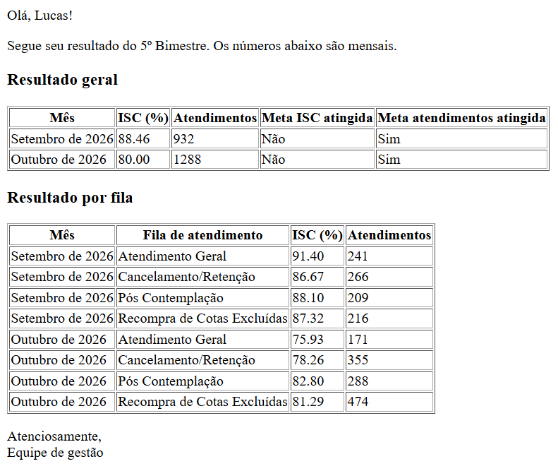
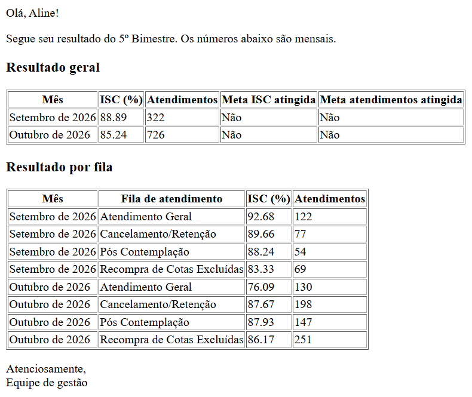

# Automação de relatórios de satisfação (ISC) por colaborador

## Sobre o projeto

Fiz esse projeto como material de estudo. É uma automatização em Python que lê a base de atendimentos, trata os dados, calcula os indicadores e gera um relatório em HTML para cada colaborador, por bimestre. O envio por e-mail ainda não está pronto (veja o Roadmap).

**Todos os dados são fictícios.** O processo foi inspirado em uma rotina real de acompanhamento de equipe, sem nenhuma informação de empresa ou de pessoas reais.

## Origem e créditos

- A estrutura do fluxo (ler um relatório do sistema, tratar, gerar um arquivo por colaborador com backup, calcular indicadores e enviar o feedback por e-mail) vem do projeto de automação do curso de Python da [Hashtag Treinamentos](https://www.hashtagtreinamentos.com/).
- A base de dados, os indicadores e a adaptação para o contexto de atendimento são de minha autoria.
- É a continuação do dashboard em Power BI que publiquei em 29/05/2026: [post no LinkedIn](https://lnkd.in/p/db3ycRBq)

### Uso de IA

- A base bruta foi gerada com ajuda de IA a partir da base do dashboard, com problemas de qualidade de propósito, para eu praticar a limpeza.
- Usei a IA para tirar dúvidas e entender erros. O tratamento e o cálculo do ISC fui montando aos poucos. O backup por mês e o relatório em HTML foram feitos com ajuda dela, e ainda estou estudando essas partes.

## Dashboard em Power BI

Prints das telas do dashboard na pasta `imagens/` e o arquivo `.pbix` em `powerbi/`.




Para abrir o `.pbix` é preciso o Power BI Desktop (Windows). Para atualizar os dados, ajuste o parâmetro de caminho em Transformar dados > Editar parâmetros.

## O que o projeto faz hoje

1. Lê a base bruta (`data/`).
2. Trata os dados: remove registros de teste e IDs duplicados, padroniza nomes de colaboradores, filas e status, converte as notas, as datas (3 formatos diferentes) e os tempos (TMA, TME e hora de início).
3. Confere o resultado: total de linhas esperado e se o mês da data bate com a coluna `Mes`.
4. Calcula o ISC e a quantidade de atendimentos por colaborador, fila e mês (agrupados por bimestre) e compara com as metas.
5. Salva um backup por colaborador, um arquivo por mês (`backup/`).
6. Pergunta qual bimestre enviar e gera um relatório em HTML para cada colaborador (`reports/`).



## Indicadores

- **ISC** = atendimentos avaliados com nota 4 ou 5 ÷ total de atendimentos avaliados (meta: 90%).
- **Atendimentos** por mês (meta: 800 por colaborador).

## Roadmap

- [x] Ler e explorar a base bruta
- [x] Tratar os dados (duplicados, registros de teste, nomes, datas e tempos em formatos diferentes)
- [x] Validar o resultado contra os totais esperados
- [x] Calcular o ISC e os atendimentos por colaborador, fila e mês
- [x] Backup por colaborador (um arquivo por mês)
- [x] Relatório em HTML por colaborador, com escolha do bimestre
- [ ] Registro de auditoria (linhas descartadas e conferência entre a base bruta e a tratada)
- [ ] % de avaliação por colaborador
- [ ] Comparar com a média da equipe e com o bimestre anterior
- [ ] Texto de feedback por regras (por exemplo, a fila com menor ISC)
- [ ] Resumo da equipe para a gestão
- [ ] Ler as metas e os destinatários das abas do Excel
- [ ] Envio por e-mail (apenas endereços de teste)
- [ ] Versão 2: ler a base de um banco SQL

## Dados

A base é uma planilha com quatro abas: Atendimentos, Colaboradores, Metas e Destinatarios. Ela foi gerada de forma sintética e tem problemas de qualidade propositais: linhas duplicadas, registros de teste, nomes, filas e status escritos de formas diferentes, notas com vírgula, datas em três formatos e tempos sem o zero à esquerda.

Por enquanto o código usa só a aba Atendimentos. As metas estão fixas no notebook, e as abas Metas e Destinatarios ainda não são lidas.

## Como executar

1. Instale o Python e as bibliotecas: `pip install pandas openpyxl`
2. Deixe a base na pasta `data/` e abra o notebook `projeto_equipe_atendimentos.ipynb` no VS Code (com a extensão Jupyter).
3. Rode as células de cima para baixo.
4. Quando aparecer a pergunta do bimestre, digite um número de 1 a 6 ou aperte Enter para usar o último da base.
5. Os arquivos são gerados em `backup/` e `reports/`.

## Estrutura de pastas

```
data/       base de entrada
imagens/    prints do dashboard e do relatório
powerbi/    arquivo .pbix
backup/     gerada pelo código (um arquivo por colaborador e mês)
reports/    gerada pelo código (relatórios em HTML)
logs/       registro de auditoria (a criar)
```

## Limitações conhecidas

- O envio por e-mail depende do Outlook clássico, como na aula, e ainda não foi testado. Por isso o relatório é salvo em HTML.
- Se a base terminar no meio de um bimestre, o relatório trata esse bimestre como fechado.
- Os dados cobrem um único ano.

## Autor

Lucas Rubens — [LinkedIn](https://www.linkedin.com/in/lucas-rubens/)
