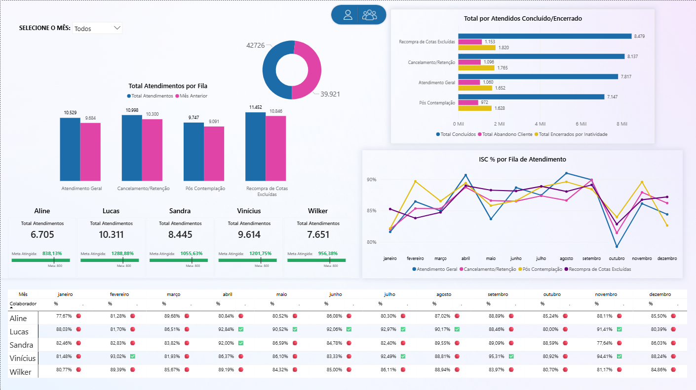
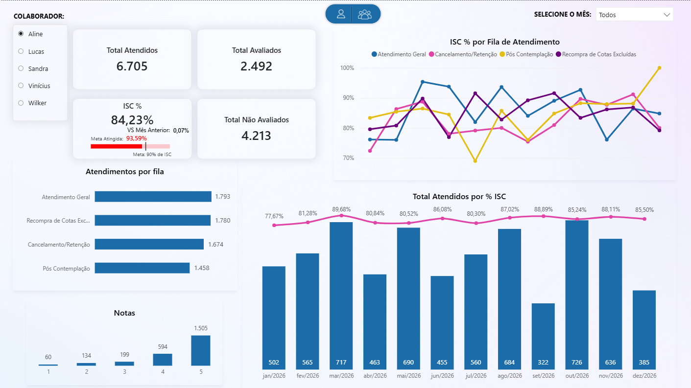

# Projeto de Automação de relatórios

## Sobre o projeto

Fiz esse projeto como material de estudo, é uma automatização de fluxo em Python, cirado para ler a base de atendimentos, trata os dados, calcular os indicadores e enviar um relatório por e-mail para cada colaborador e um resumo geral da equipe para a gestão.

**Todos os dados são fictícios**. O processo foi inspirado em uma rotina real de acompanhamento de equipe, sem nenhuma informação de empresa ou de pessoas reais.

## Origem e créditos

- A estrutura do fluxo (le uma único relatório do sistema, trata, gera um arquivo por colaborador com backup, calcula indicadores e envia por e-mail o feedback) é uma parte do projeto de automação do curso de Python da [Hashtag Treinamentos](https://www.hashtagtreinamentos.com/).
- A base de dados, os indicadores, as regras de feedback e a adaptação para o contexto de atendimento são de minha autoria.
- Continuação do dashboard em Power BI que publiquei em 29/05/2026: [https://lnkd.in/p/db3ycRBq]
- Adicionei na pasta imagens/ prints das telas do arquivo pbix



## Indicadores

- **Atendimentos**, **avaliados** e **% de avaliação** por operador e bimestre
- **ISC** = atendimentos avaliados ÷ total de avaliados (meta: 90%)
- ISC por fila de atendimento, comparado com a média da equipe e com o bimestre anterior
- Fila com o menor ISC de cada operador, como ponto de atenção no feedback

## Roadmap

- [ ] Ler e explorar a base bruta
- [ ] Tratar os dados (duplicados, registros de teste, nomes, datas e tempos em formatos diferentes)
- [ ] Validar o resultado contra os totais esperados
- [ ] Calcular os indicadores por operador e bimestre
- [ ] Gerar um arquivo por operador, com backup
- [ ] Montar o texto de feedback a partir de regras
- [ ] Enviar os relatórios por e-mail (apenas endereços de teste)

## Dados

A base é composta por: fila de atendimento, colaboradores, metas e destinatários. Ela foi gerada de forma sintética e contém problemas de qualidade propositais.

## Tecnologias

Python, pandas, envio de e-mail (SMTP) e Git. *(ainda em atualização ao longo do projeto)*

## Estrutura de pastas (planejada)
*ainda em ajuste*
```
data/       bases de entrada
src/        código do projeto
reports/    relatórios gerados
logs/       registros de execução
```

Lucas Rubens — [https://www.linkedin.com/in/lucas-rubens/]
